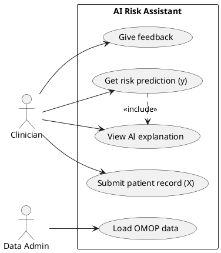
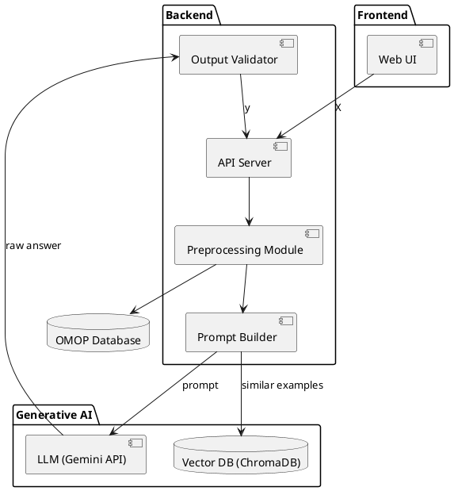
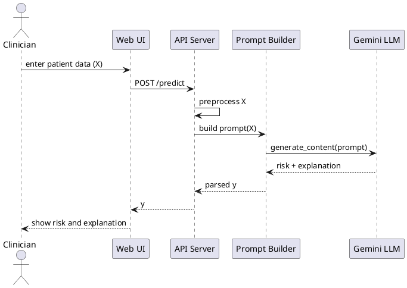
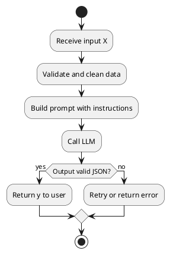

# Laboratory Work Guide (Labs 1.2 – 1.6)

> **Update:** the finished assignment is in the folder [`omop-ai-agent-labs/`](omop-ai-agent-labs/).
> Follow [`omop-ai-agent-labs/HOW_TO_COMPLETE.md`](omop-ai-agent-labs/HOW_TO_COMPLETE.md) for the remaining manual steps
> (GitHub upload, Colab runs, hand drawing, PNG rendering). The generic guide below is kept for reference.

This guide explains every remaining laboratory task from *"All laboratory work should be done.docx"*.
Lab 1.1 (NotebookLM) is already done, so it is skipped.

> **Important rule from the assignment:** all labs must be completed before the exam.
> If a lab is reported late, you must submit a **complete written description** of it.
> So for every lab below, keep a short write-up (a `README.md` section or a `docs/lab-1.x.md` file) in your GitHub repo.

---

## 0. Before you start — one-time setup

### 0.1 Define your thesis as `X → y`

Every lab from 1.2 to 1.6 is built on one idea: your thesis system takes an **input X** and produces an **output y**.
Write this down first, in one sentence. Everything else follows from it.

| Question | Your answer (fill in) |
|---|---|
| What is the thesis title? | … |
| What goes **into** the system (X)? | e.g. a patient record, a text, an image, a sensor reading |
| What comes **out** (y)? | e.g. a class label, a risk score, a summary, a recommendation |
| Type of task | classification / regression / generation / extraction / recommendation |
| Where does AI (LLM / ML) sit in the pipeline? | … |

**Worked example used in this guide** (replace with your own topic):
*Thesis: "AI-assisted clinical risk prediction from OMOP-formatted patient data."*

- **X** = a patient summary (age, sex, diagnoses, lab values, medications), as JSON.
- **y** = a risk level (`low` / `medium` / `high`) plus a short explanation.

### 0.2 Recommended GitHub repository layout

Create this structure now. Each lab fills one or more folders.

```
your-thesis-repo/
├── README.md               # project overview + links to every lab
├── data/                   # Lab 1.2 – (X, y) examples
│   ├── README.md
│   ├── examples.json
│   └── rag_dataset.jsonl   # Lab 1.6 – 1,000+ examples
├── diagrams/               # Lab 1.2 hand drawing + Lab 1.3 PlantUML
│   ├── process_model_handdrawn.jpg
│   ├── use_case.puml
│   ├── component.puml
│   ├── sequence.puml
│   └── *.png               # rendered images
├── docs/                   # written descriptions per lab
│   ├── lab-1.2.md
│   ├── lab-1.3.md
│   └── ...
├── prompts/                # Lab 1.4
│   ├── README.md
│   ├── prompt1_zero_shot.md
│   └── prompt2_few_shot.md
└── notebooks/              # Lab 1.5 and 1.6
    ├── lab_1_5_end_to_end_gemini.ipynb
    └── lab_1_6_rag_chromadb.ipynb
```

---

## Lab 1.2 — Project as an end-to-end solution (deadline: September 30)

### What is asked

1. Give examples of **(X, y)** pairs from your thesis and put them on GitHub in `\data\`.
2. Understand and explain how the **two Colab notebooks** given by the lecturer work.
3. Create a **preliminary process model** showing how AI is used in your thesis.
4. **Hand-draw** that diagram.

### Step 1 — Write (X, y) examples

Create `data/examples.json` with at least 5–10 pairs. Use realistic values. Keep one consistent format.

```json
[
  {
    "id": 1,
    "X": {
      "age": 67, "sex": "M",
      "conditions": ["type 2 diabetes", "hypertension"],
      "labs": {"HbA1c": 8.9, "creatinine": 1.6},
      "medications": ["metformin", "lisinopril"]
    },
    "y": {
      "risk": "high",
      "explanation": "Poorly controlled diabetes with reduced kidney function."
    }
  },
  {
    "id": 2,
    "X": {
      "age": 34, "sex": "F",
      "conditions": [],
      "labs": {"HbA1c": 5.2, "creatinine": 0.8},
      "medications": []
    },
    "y": {
      "risk": "low",
      "explanation": "Young patient, no chronic conditions, normal labs."
    }
  }
]
```

Then create `data/README.md` that explains:

- **What X is:** each field, its type, unit, and allowed values.
- **What y is:** the output format and allowed values.
- **Where the data comes from:** real dataset, synthetic, or hand-made.
- **Why these examples matter:** they are later reused in Lab 1.4 (few-shot) and Lab 1.6 (RAG).

> Tip: if your data is private (e.g. medical), use **synthetic** or **anonymised** examples only. Never upload real personal data to GitHub.

### Step 2 — Explain the two Colab notebooks

The links in the assignment (`1 Collaborate`, `2 Collaborate`) did not survive in the .docx text. Open them from the original course page or Moodle.

For **each** notebook, write a section in `docs/lab-1.2.md` with this template:

```markdown
## Notebook N: <title>

**Goal:** what problem the notebook solves (one or two sentences).

**Input (X):** what data goes in, and in what format.
**Output (y):** what the notebook produces.

**Step-by-step walkthrough:**
1. Install / import libraries — which ones and why.
2. Load data — from where, what shape.
3. Preprocess — cleaning, encoding, splitting train/test.
4. Model / AI call — which model or API, which parameters.
5. Evaluate / display — metrics, plots, printed outputs.

**Key concepts I learned:** e.g. embeddings, prompting, train/test split.

**How it relates to my thesis:** which part I can reuse.
```

How to understand a notebook quickly:

1. Click **Runtime → Run all**. Note any errors.
2. Read each code cell. Write one comment above it: "This cell does …".
3. Print the shape and a sample of every important variable (`print(df.head())`, `print(type(x))`).
4. Identify where X enters and where y leaves. That is the end-to-end path.

### Step 3 — Preliminary process model

Describe your system as **stages**. A typical AI pipeline:

```
[Raw data] → [Data understanding / preprocessing] → [AI model / LLM inference]
          → [Reasoning / post-processing / validation] → [Output y] → [User / feedback]
```

For the worked example:

1. **Input:** patient record from an OMOP database (X).
2. **Data understanding:** extract age, conditions, labs, drugs; normalise units.
3. **Inference:** the LLM (or ML model) estimates the risk.
4. **Reasoning:** the model explains which factors drove the risk.
5. **Output:** risk level + explanation shown to the clinician (y).
6. **Feedback loop:** the clinician confirms or corrects, which improves future examples.

Mark clearly **which boxes use AI** (e.g. colour them or add an "AI" label).

### Step 4 — Hand-draw the diagram

- Draw on paper: boxes for stages, arrows for data flow, label X at the start and y at the end.
- Mark the AI components clearly.
- Take a clear photo or scan. Save as `diagrams/process_model_handdrawn.jpg`.
- Reference it in `docs/lab-1.2.md`: ``.

### Deliverables checklist for 1.2

- [ ] `data/examples.json` with (X, y) pairs
- [ ] `data/README.md` explaining the data
- [ ] `docs/lab-1.2.md` explaining both Colab notebooks
- [ ] Process model description (stages, AI parts)
- [ ] Hand-drawn diagram photo in `diagrams/`

---

## Lab 1.3 — Company + UML diagrams with PlantUML (deadline: October 1)

### What is asked

1. Find a **company** that best fits your final project solution.
2. Draw **UML diagrams** with **PlantUML** (with help from an LLM) showing how **Generative AI (GAI)** is integrated into your product.
3. Use the PlantUML editor (https://www.plantuml.com/plantuml or https://editor.plantuml.com) to test and display.

### Step 1 — Choose the company

Pick a real company that could **use or sell** your thesis product. Write in `docs/lab-1.3.md`:

- **Company name and domain** (e.g. a hospital network, a health-tech startup, a bank, a logistics firm).
- **Their current problem** that your system solves.
- **Why your solution fits** (data they have, process they run, scale).
- **Who the users are** (roles: doctor, analyst, customer, admin).
- **Value:** time saved, cost reduced, quality improved.

### Step 2 — Generate diagrams with an LLM

Ask an LLM (ChatGPT, Gemini, Claude) with a prompt like this:

```
My thesis: <one-sentence description>.
Input X: <...>. Output y: <...>.
Target company: <name>, users: <roles>.
Generative AI (LLM) is used for: <what exactly>.

Generate PlantUML code for:
1. A use case diagram (actors and main use cases).
2. A component diagram showing where the LLM sits in the system.
3. A sequence diagram for one request from user input X to output y.
4. An activity diagram of the full pipeline.
Use @startuml / @enduml for each diagram.
```

Paste the result into the PlantUML editor. Fix errors. Make sure the diagrams match **your** design, not a generic one.

### Step 3 — Recommended diagrams (templates)

**Use case diagram** — `diagrams/use_case.puml`



**Component diagram** — `diagrams/component.puml`



**Sequence diagram** — `diagrams/sequence.puml`



**Activity diagram** — `diagrams/activity.puml`



### Step 4 — Save and document

- Save each `.puml` file in `diagrams/`.
- Export each diagram as `.png` from the editor and save next to it.
- In `docs/lab-1.3.md`, show each image and write 2–3 sentences explaining it.
- Mention which LLM you used and what you corrected by hand.

### Deliverables checklist for 1.3

- [ ] Company chosen and justified
- [ ] At least 3 UML diagrams (use case, component, sequence; activity is a bonus)
- [ ] `.puml` source files + `.png` images in `diagrams/`
- [ ] Explanation of where GAI is integrated

---

## Lab 1.4 — Single AI agent + prompts (deadline: October 30)

### What is asked

1. Conceptualise your thesis system as **one AI agent** that receives X, runs all stages (data understanding → inference → reasoning → output generation), and returns y.
2. Create a `/prompts/` folder in GitHub.
3. Write **Prompt 1 (zero-shot):** one new X, ask for y.
4. Write **Prompt 2 (few-shot):** same as Prompt 1, plus several known (X, y) pairs from Lab 1.2.

### Step 1 — Describe the agent

In `prompts/README.md`, describe the agent:

```markdown
# AI Agent: <name>

**Role:** <what the agent is, e.g. "clinical risk assessment assistant">

**Input X:** <format>
**Output y:** <format>

**Internal stages:**
1. Data understanding – read and interpret the fields of X.
2. Inference – estimate the result.
3. Reasoning – explain why, step by step.
4. Output generation – return y in a fixed JSON format.

**Constraints:** only use the given data; say "uncertain" if data is missing; no invented facts.
```

### Step 2 — Prompt structure

A good prompt has these parts:

1. **Role** — who the model is.
2. **Task** — what to do.
3. **Stages** — the pipeline steps the agent must follow.
4. **Output format** — exact JSON schema, so code can parse it.
5. **Examples** — only in few-shot.
6. **Input** — the new X.

### Step 3 — Prompt 1: zero-shot (`prompts/prompt1_zero_shot.md`)

```markdown
# Prompt 1 – Zero-shot

## Purpose
Ask the agent to predict y for a single new input X, with no examples.

## Prompt
You are a clinical risk assessment AI agent.
Your task: given one patient record (X), predict the patient's health risk level (y).

Follow these stages:
1. Data understanding: list the relevant facts in the record.
2. Inference: decide the risk level: low, medium, or high.
3. Reasoning: explain which factors caused this decision.
4. Output: return ONLY valid JSON in this format:
   {"risk": "low|medium|high", "explanation": "<one or two sentences>"}

Patient record (X):
{"age": 58, "sex": "F", "conditions": ["hypertension"],
 "labs": {"HbA1c": 6.1, "creatinine": 1.1}, "medications": ["amlodipine"]}

## Expected output (example)
{"risk": "medium", "explanation": "Controlled hypertension and prediabetic HbA1c raise risk moderately."}
```

### Step 4 — Prompt 2: few-shot (`prompts/prompt2_few_shot.md`)

Same prompt, but add 3–5 (X, y) pairs from `data/examples.json` **before** the new X.

```markdown
# Prompt 2 – Few-shot

## Purpose
Same task as Prompt 1, but the agent sees known (X, y) examples from Lab 1.2 first.

## Prompt
You are a clinical risk assessment AI agent.
Your task: given one patient record (X), predict the risk level (y).
Follow the stages: data understanding → inference → reasoning → output.
Return ONLY valid JSON: {"risk": "low|medium|high", "explanation": "..."}

Here are solved examples:

Example 1
X: {"age": 67, "sex": "M", "conditions": ["type 2 diabetes", "hypertension"], "labs": {"HbA1c": 8.9, "creatinine": 1.6}, "medications": ["metformin", "lisinopril"]}
y: {"risk": "high", "explanation": "Poorly controlled diabetes with reduced kidney function."}

Example 2
X: {"age": 34, "sex": "F", "conditions": [], "labs": {"HbA1c": 5.2, "creatinine": 0.8}, "medications": []}
y: {"risk": "low", "explanation": "Young patient, no chronic conditions, normal labs."}

Example 3
X: {...}
y: {...}

Now solve the new case:
X: {"age": 58, "sex": "F", "conditions": ["hypertension"], "labs": {"HbA1c": 6.1, "creatinine": 1.1}, "medications": ["amlodipine"]}
y:
```

### Step 5 — Test and compare

- Run both prompts in any chat LLM (Gemini, ChatGPT, Claude).
- Save the real answers in each prompt file under `## Actual output`.
- In `prompts/README.md`, compare: did few-shot give a more consistent format? more correct answer? better explanation?

### Deliverables checklist for 1.4

- [ ] `prompts/README.md` – agent description + comparison
- [ ] `prompts/prompt1_zero_shot.md` – prompt + output
- [ ] `prompts/prompt2_few_shot.md` – prompt using Lab 1.2 examples + output

---

## Lab 1.5 — End-to-end demo in Google Colab with Gemini API (deadline: November 15)

### What is asked

1. A Colab notebook with a **title** and **short description** of your system.
2. Clear **text cells** (explanations) and **code cells** (implementation).
3. Gemini API key stored in **Colab Secrets** as `GEMINI_KEY` — never hardcoded.
4. Run the two Lab 1.4 prompts through Gemini. Show X, reasoning, y.
5. Show the full pipeline: data understanding → reasoning → inference → output.
6. Visualise the flow or results.
7. Save `.ipynb` in GitHub under `/notebooks/` and write a 5–10 sentence reflection.

### Step 1 — Get a Gemini API key

1. Go to https://aistudio.google.com/apikey.
2. Click **Create API key**. Copy it.
3. In Colab: click the **key icon (Secrets)** in the left sidebar (or **Tools → Secrets**).
4. Add a new secret: name `GEMINI_KEY`, value = your key. Turn on **Notebook access**.

> **Security:** never paste the key into a code cell, and never commit it to GitHub. If you leak it by mistake, delete it in AI Studio and create a new one.

### Step 2 — Notebook structure

Use this order of cells. **(M)** = markdown cell, **(C)** = code cell.

**(M) Cell 1 – Title and description**

```markdown
# <Thesis title> – End-to-End AI Agent Demo
This notebook demonstrates my thesis system as a complete AI agent.
Input X: <...>. Output y: <...>.
The agent uses the Gemini API and prompt engineering (Lab 1.4) to run the pipeline:
data understanding → reasoning → inference → output generation.
```

**(C) Cell 2 – Install and import**

```python
!pip install -q google-genai

import json
from google import genai
from google.colab import userdata
```

**(C) Cell 3 – Load the key securely**

```python
GEMINI_KEY = userdata.get('GEMINI_KEY')   # loaded from Colab Secrets, not hardcoded
client = genai.Client(api_key=GEMINI_KEY)
MODEL = "gemini-2.5-flash"                # check AI Studio for the current model names
```

**(M) Cell 4 – Explain the prompts from Lab 1.4**

**(C) Cell 5 – Load prompts and examples**

Either download them from GitHub or recreate them in code.

```python
# Option A: download from your GitHub repo (use the "raw" URL)
!wget -q https://raw.githubusercontent.com/<user>/<repo>/main/data/examples.json

with open("examples.json") as f:
    EXAMPLES = json.load(f)

# Option B: define them directly
SYSTEM_PROMPT = """You are a clinical risk assessment AI agent.
Follow these stages:
1. Data understanding: list the relevant facts.
2. Inference: decide the risk level: low, medium, or high.
3. Reasoning: explain which factors caused this decision.
4. Output: return ONLY valid JSON:
{"facts": [...], "reasoning": "...", "risk": "low|medium|high", "explanation": "..."}
"""
```

Asking for `facts` and `reasoning` fields in the JSON makes the **intermediate steps visible**, which the assignment requires.

**(M) + (C) Cells 6–9 – One cell per pipeline stage**

```python
# ---------- Stage 1: Data understanding ----------
def understand_input(raw_x: dict) -> dict:
    """Clean and validate the raw input X."""
    x = dict(raw_x)
    x.setdefault("conditions", [])
    x.setdefault("medications", [])
    print("Stage 1 – cleaned input:", json.dumps(x, indent=2))
    return x

# ---------- Stage 2: Prompt building ----------
def build_zero_shot(x: dict) -> str:
    return f"{SYSTEM_PROMPT}\nPatient record (X):\n{json.dumps(x)}"

def build_few_shot(x: dict, examples: list, k: int = 3) -> str:
    shots = "\n\n".join(
        f"Example {i+1}\nX: {json.dumps(e['X'])}\ny: {json.dumps(e['y'])}"
        for i, e in enumerate(examples[:k])
    )
    return f"{SYSTEM_PROMPT}\nSolved examples:\n{shots}\n\nNow solve:\nX: {json.dumps(x)}\ny:"

# ---------- Stage 3: Inference + reasoning (Gemini) ----------
def call_gemini(prompt: str) -> str:
    response = client.models.generate_content(
        model=MODEL,
        contents=prompt,
        config={"response_mime_type": "application/json", "temperature": 0.2},
    )
    return response.text

# ---------- Stage 4: Output generation ----------
def parse_output(text: str) -> dict:
    try:
        return json.loads(text)
    except json.JSONDecodeError:
        return {"error": "invalid JSON", "raw": text}

# ---------- Full pipeline ----------
def run_agent(raw_x: dict, mode: str = "zero-shot") -> dict:
    x = understand_input(raw_x)
    prompt = build_zero_shot(x) if mode == "zero-shot" else build_few_shot(x, EXAMPLES)
    print(f"\nStage 2 – prompt ({mode}):\n{prompt}\n")
    raw = call_gemini(prompt)
    print("Stage 3 – raw model answer:\n", raw)
    y = parse_output(raw)
    print("\nStage 4 – final output y:\n", json.dumps(y, indent=2))
    return y
```

**(C) Cell 10 – Run both prompts**

```python
new_x = {"age": 58, "sex": "F", "conditions": ["hypertension"],
         "labs": {"HbA1c": 6.1, "creatinine": 1.1}, "medications": ["amlodipine"]}

y_zero = run_agent(new_x, mode="zero-shot")
y_few  = run_agent(new_x, mode="few-shot")
```

**(C) Cell 11 – Visualisation**

Pick at least one:

- **Printed logs** (already shown by the stage prints above).
- **Pipeline diagram** with graphviz:

```python
from graphviz import Digraph
g = Digraph(graph_attr={"rankdir": "LR"})
for n in ["Input X", "Data understanding", "Prompt building",
          "Gemini inference + reasoning", "Output y"]:
    g.node(n, shape="box")
edges = [("Input X", "Data understanding"), ("Data understanding", "Prompt building"),
         ("Prompt building", "Gemini inference + reasoning"),
         ("Gemini inference + reasoning", "Output y")]
for a, b in edges:
    g.edge(a, b)
g
```

- **Results table / chart:** run the agent on all examples in `examples.json`, compare predicted vs true y, show accuracy with `pandas` and a bar chart in `matplotlib`.

```python
import pandas as pd
rows = []
for e in EXAMPLES:
    pred = parse_output(call_gemini(build_zero_shot(e["X"])))
    rows.append({"id": e["id"], "true": e["y"]["risk"], "pred": pred.get("risk")})
df = pd.DataFrame(rows)
df["correct"] = df["true"] == df["pred"]
print(df)
print("Accuracy:", df["correct"].mean())
```

**(M) Cell 12 – Reflection (5–10 sentences)**

Answer these points:

1. What the system does as a complete AI agent.
2. How Gemini was used (model, JSON output, temperature).
3. How prompt engineering was used (zero-shot vs few-shot, stage instructions, output schema).
4. What worked well (e.g. stable JSON, sensible explanations).
5. What could be improved (e.g. more examples, validation, retrieval of relevant examples → leads to Lab 1.6).

### Step 3 — Save to GitHub

- In Colab: **File → Save a copy in GitHub**, choose your repo and path `notebooks/lab_1_5_end_to_end_gemini.ipynb`.
  Or: **File → Download .ipynb**, then commit it.
- **Before saving, check that no output cell prints the API key.**
- Add the notebook link and the "Open in Colab" badge to the main `README.md`.

### Deliverables checklist for 1.5

- [ ] Notebook with title + description
- [ ] Key loaded via `userdata.get('GEMINI_KEY')`
- [ ] Both Lab 1.4 prompts run through Gemini, X / reasoning / y shown
- [ ] Each pipeline stage in its own documented cell
- [ ] At least one visualisation
- [ ] Reflection (5–10 sentences)
- [ ] `.ipynb` in `notebooks/` and linked in README

---

## Lab 1.6 — RAG extension with ChromaDB (deadline: November 30)

### What is asked

1. Generate or collect **at least 1,000 (X, y) examples**.
2. Store them in a **ChromaDB** vector database with embeddings.
3. For a new X, retrieve the **3 most similar** examples.
4. Put those 3 examples into the prompt (augmented prompt) and call Gemini.
5. Show in Colab: **Input X → Retrieve 3 → Augmented prompt → Generate y**.
6. Write a 5–10 sentence reflection on how RAG improved the system.

### What RAG means here

In Lab 1.5 the few-shot examples were **fixed** (always the same 3). In RAG, the examples are **chosen per query**: the database returns the 3 examples most similar to the new X. Similar examples are better hints, so the answer is usually more accurate and consistent.

```
New X ──embed──▶ vector ──search ChromaDB──▶ top-3 similar (X, y)
                                                  │
           Gemini ◀── augmented prompt (instructions + 3 examples + new X)
              │
              ▼
           Output y
```

### Step 1 — Get 1,000+ examples

Options, from best to simplest:

1. **Real public dataset** related to your thesis (Kaggle, UCI, Hugging Face, PhysioNet, synthetic OMOP like Synthea). Convert each row to an (X, y) pair.
2. **Rule-based synthetic generator** in Python — fast, free, no API cost. Shown below.
3. **LLM-generated** examples (ask Gemini for batches of 50). Slower and uses quota; check quality.

Synthetic generator for the worked example (adapt the fields and the labelling rule to your thesis):

```python
import random, json
random.seed(42)

CONDITIONS = ["type 2 diabetes", "hypertension", "heart failure", "asthma",
              "chronic kidney disease", "obesity", "COPD"]
MEDS = ["metformin", "lisinopril", "amlodipine", "insulin", "atorvastatin", "salbutamol"]

def make_x():
    return {
        "age": random.randint(18, 90),
        "sex": random.choice(["M", "F"]),
        "conditions": random.sample(CONDITIONS, k=random.randint(0, 3)),
        "labs": {"HbA1c": round(random.uniform(4.5, 11.0), 1),
                 "creatinine": round(random.uniform(0.6, 2.5), 2)},
        "medications": random.sample(MEDS, k=random.randint(0, 3)),
    }

def label(x):
    score = 0
    score += (x["age"] > 65) + (x["age"] > 80)
    score += len(x["conditions"])
    score += (x["labs"]["HbA1c"] > 6.5) + (x["labs"]["HbA1c"] > 8.5)
    score += (x["labs"]["creatinine"] > 1.3) * 2
    risk = "low" if score <= 2 else "medium" if score <= 4 else "high"
    return {"risk": risk, "explanation": f"Risk score {score} from age, conditions and labs."}

data = []
for i in range(1200):
    x = make_x()
    data.append({"id": i, "X": x, "y": label(x)})

with open("rag_dataset.jsonl", "w") as f:
    for d in data:
        f.write(json.dumps(d) + "\n")
print(len(data), "examples saved")
```

Upload `rag_dataset.jsonl` to `data/` in GitHub and explain in `data/README.md` how it was made.

### Step 2 — Store in ChromaDB

**Text to embed:** turn each X into a readable sentence. Embeddings work better on natural text than on raw JSON.

```python
!pip install -q chromadb google-genai

import json, chromadb
from chromadb.utils import embedding_functions

def x_to_text(x):
    return (f"Age {x['age']}, sex {x['sex']}. Conditions: {', '.join(x['conditions']) or 'none'}. "
            f"HbA1c {x['labs']['HbA1c']}, creatinine {x['labs']['creatinine']}. "
            f"Medications: {', '.join(x['medications']) or 'none'}.")

data = [json.loads(line) for line in open("rag_dataset.jsonl")]

# Free local embedding model (all-MiniLM-L6-v2), no API quota needed
embed_fn = embedding_functions.SentenceTransformerEmbeddingFunction(
    model_name="all-MiniLM-L6-v2")

chroma = chromadb.PersistentClient(path="./chroma_db")
collection = chroma.get_or_create_collection(name="thesis_examples",
                                             embedding_function=embed_fn)

BATCH = 200
for i in range(0, len(data), BATCH):
    chunk = data[i:i+BATCH]
    collection.add(
        ids=[str(d["id"]) for d in chunk],
        documents=[x_to_text(d["X"]) for d in chunk],
        metadatas=[{"X": json.dumps(d["X"]), "y": json.dumps(d["y"])} for d in chunk],
    )
print("Stored:", collection.count())
```

> Alternative: use Gemini embeddings (`client.models.embed_content(model="gemini-embedding-001", contents=[...])`) and pass `embeddings=` to `collection.add`. This counts against your API quota, so the local model is the safer default for 1,000+ items.

### Step 3 — Retrieve the top 3

```python
def retrieve(x, k=3):
    res = collection.query(query_texts=[x_to_text(x)], n_results=k)
    hits = []
    for meta, dist in zip(res["metadatas"][0], res["distances"][0]):
        hits.append({"X": json.loads(meta["X"]), "y": json.loads(meta["y"]), "distance": dist})
    return hits

new_x = {"age": 58, "sex": "F", "conditions": ["hypertension"],
         "labs": {"HbA1c": 6.1, "creatinine": 1.1}, "medications": ["amlodipine"]}

top3 = retrieve(new_x)
for i, h in enumerate(top3, 1):
    print(f"#{i} distance={h['distance']:.3f}\n  X={h['X']}\n  y={h['y']}")
```

Lower distance = more similar.

### Step 4 — Augmented prompt + Gemini

```python
from google import genai
from google.colab import userdata
client = genai.Client(api_key=userdata.get('GEMINI_KEY'))
MODEL = "gemini-2.5-flash"

def build_rag_prompt(x, hits):
    shots = "\n\n".join(
        f"Similar case {i+1} (distance {h['distance']:.3f})\nX: {json.dumps(h['X'])}\ny: {json.dumps(h['y'])}"
        for i, h in enumerate(hits))
    return f"""{SYSTEM_PROMPT}
The following solved cases were retrieved from a database because they are similar to the new case.
Use them as reference, but reason about the new case itself.

{shots}

New case:
X: {json.dumps(x)}
y:"""

def rag_agent(x):
    print("STEP 1 – Input X:\n", json.dumps(x, indent=2))
    hits = retrieve(x, k=3)
    print("\nSTEP 2 – Retrieved 3 examples:")
    for h in hits:
        print(" ", h["y"]["risk"], "|", x_to_text(h["X"]))
    prompt = build_rag_prompt(x, hits)
    print("\nSTEP 3 – Augmented prompt:\n", prompt)
    resp = client.models.generate_content(
        model=MODEL, contents=prompt,
        config={"response_mime_type": "application/json", "temperature": 0.2})
    y = json.loads(resp.text)
    print("\nSTEP 4 – Generated y:\n", json.dumps(y, indent=2))
    return y

y = rag_agent(new_x)
```

### Step 5 — Show that RAG helps (evaluation)

Take ~30 test examples **not** in the database (generate them with a different seed). Compare three modes:

| Mode | Examples in prompt |
|---|---|
| Zero-shot | none |
| Fixed few-shot | same 3 examples always (Lab 1.5) |
| RAG | 3 most similar examples (Lab 1.6) |

```python
import pandas as pd
results = []
for t in test_set:   # list of {"X":..., "y":...}
    for mode, prompt in [
        ("zero-shot", build_zero_shot(t["X"])),
        ("few-shot",  build_few_shot(t["X"], EXAMPLES)),
        ("rag",       build_rag_prompt(t["X"], retrieve(t["X"]))),
    ]:
        pred = parse_output(call_gemini(prompt)).get("risk")
        results.append({"mode": mode, "correct": pred == t["y"]["risk"]})

df = pd.DataFrame(results)
summary = df.groupby("mode")["correct"].mean()
print(summary)
summary.plot(kind="bar", title="Accuracy by prompting mode", ylim=(0, 1))
```

> Free-tier Gemini has rate limits. If you hit errors, add `time.sleep(4)` between calls or use fewer test cases.

### Step 6 — Reflection (5–10 sentences)

Cover:

1. Size and source of the dataset; embedding model; ChromaDB setup.
2. How retrieval chose relevant examples (give one concrete case).
3. Accuracy / consistency: zero-shot vs few-shot vs RAG (use your numbers).
4. Reliability: answers are grounded in real similar cases, which reduces guessing.
5. Limitations: quality depends on dataset quality; synthetic labels may be simplistic; retrieval can return near-duplicates.
6. Next improvements: hybrid search, metadata filters, larger or real dataset, re-ranking.

### Deliverables checklist for 1.6

- [ ] 1,000+ (X, y) examples in `data/rag_dataset.jsonl` + explanation
- [ ] ChromaDB collection with embeddings
- [ ] Top-3 retrieval function
- [ ] Augmented prompt sent to Gemini
- [ ] Colab demo showing X → retrieve 3 → augmented prompt → y
- [ ] Comparison (zero-shot vs few-shot vs RAG), ideally with a chart
- [ ] Reflection (5–10 sentences)
- [ ] `notebooks/lab_1_6_rag_chromadb.ipynb` committed and linked in README

---

## Final checklist — what the lecturer will look for

| Lab | Deadline | Main evidence in GitHub |
|---|---|---|
| 1.1 | Sep 17 | Done (NotebookLM) |
| 1.2 | Sep 30 | `data/examples.json`, `data/README.md`, `docs/lab-1.2.md`, hand-drawn diagram |
| 1.3 | Oct 1 | Company justification, `diagrams/*.puml` + `.png` |
| 1.4 | Oct 30 | `prompts/README.md`, zero-shot and few-shot prompt files |
| 1.5 | Nov 15 | `notebooks/lab_1_5_end_to_end_gemini.ipynb` + reflection |
| 1.6 | Nov 30 | `data/rag_dataset.jsonl`, `notebooks/lab_1_6_rag_chromadb.ipynb` + reflection |

Recommended order of work: **1.2 → 1.4 → 1.5 → 1.6**, then **1.3** (the UML diagrams are easier once the pipeline exists, and they can show the RAG component too).

Because some deadlines have passed, write a complete description for each late lab (in `docs/lab-1.x.md`), as the assignment requires.
